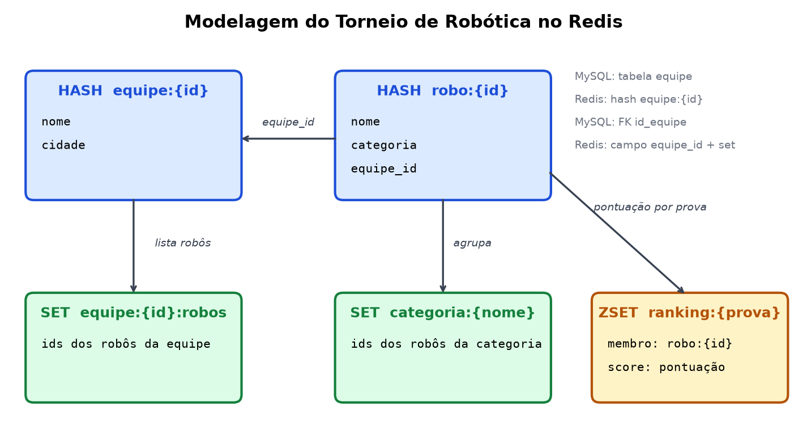

# Módulo NoSQL: Redis

Segunda parte da entrega (30%). O Redis guarda os mesmos dados do torneio em estruturas chave-valor.

## Instalação (Docker)

```bash
docker run -d --name redis-torneio -p 6379:6379 redis:7
docker exec -it redis-torneio redis-cli
```

## Modelagem



| Estrutura | Chave | Conteúdo |
|---|---|---|
| Hash | `equipe:{id}` | nome, cidade |
| Hash | `robo:{id}` | nome, categoria, equipe_id |
| Set | `equipe:{id}:robos` | ids dos robôs da equipe |
| Set | `categoria:{nome}` | ids dos robôs da categoria |
| Sorted set | `ranking:{prova}` | membro `robo:{id}`, score = pontuação |

## Como rodar

Carga de exemplo e CRUD. O arquivo `torneio.redis` segue esta ordem: limpar o banco (`FLUSHDB`), criar equipes e robôs (hashes), relacionamentos (sets), rankings (sorted sets), consultas (`HGETALL`, `SMEMBERS`, `SINTER`, `ZREVRANGE`), atualizações (`HSET`, `ZINCRBY`) e exclusões (`SREM`, `ZREM`, `DEL`). O `redis-cli` não aceita comentários, por isso o arquivo tem só comandos.

```bash
docker exec -i redis-torneio redis-cli < redis/torneio.redis
```

Migração completa a partir do MySQL (precisa do `.env` e do banco criados):

```bash
pip install -r redis/requirements.txt
python redis/mysql_para_redis.py
```

## MySQL × Redis

| | MySQL | Redis |
|---|---|---|
| Modelo | tabelas e FKs | chaves e estruturas |
| Integridade | FK, triggers, procedures | feita pela aplicação |
| Ranking | `ORDER BY` + procedure | `ZADD` / `ZREVRANGE`, já ordenado |
| Consulta com junção | `JOIN` | `SINTER` entre sets |
| Melhor uso | dados relacionais e regras | leitura rápida, rankings, cache |
